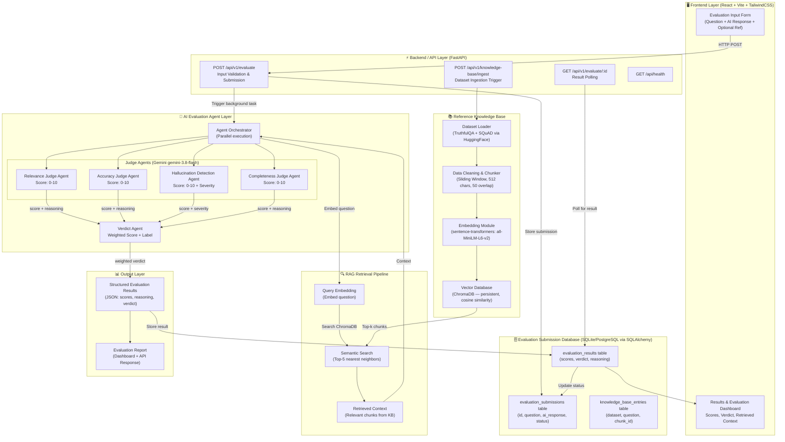

# System Architecture — AI Hallucination Evaluation System

## M1.2 — System Architecture Design

---

## Architecture Overview



---

## Component Responsibilities

### 1. Evaluation Input Module (M1.3)
**Path**: `backend/api/routes/evaluation.py`

| Responsibility | Details |
|----------------|---------|
| Accept submissions | `POST /api/v1/evaluate` |
| Input validation | Pydantic schema: required question + ai_response, optional reference_answer + source_document |
| Error handling | Min/max length, blank validation, HTTP 422 on schema error |
| Async processing | Returns `evaluation_id` immediately; evaluation runs in background |
| Result retrieval | `GET /api/v1/evaluate/{id}` for polling |

---

### 2. Agent Orchestrator
**Path**: `backend/core/orchestrator.py`

| Responsibility | Details |
|----------------|---------|
| Coordinate agents | Runs all 4 judge agents in parallel with `asyncio.gather()` |
| Context injection | Provides retrieved context to each agent |
| Result aggregation | Collects all agent outputs and passes to Verdict Agent |
| Error isolation | Individual agent failures don't crash the pipeline |

---

### 3. Relevance Judge Agent
**Path**: `backend/agents/relevance_agent.py`

| Responsibility | Details |
|----------------|---------|
| Input | Question + AI Response + Context |
| Evaluation | Does the response address the question? |
| Output | `{"score": 0-10, "reasoning": "...", "issues": [...]}` |
| Model | Gemini `gemini-3.8-flash` with structured JSON prompt |

---

### 4. Accuracy Judge Agent
**Path**: `backend/agents/accuracy_agent.py`

| Responsibility | Details |
|----------------|---------|
| Input | Question + AI Response + Reference Answer + Context |
| Evaluation | Are the stated facts correct and verifiable? |
| Output | `{"score": 0-10, "reasoning": "...", "incorrect_claims": [...]}` |
| Model | Gemini `gemini-3.8-flash` |

---

### 5. Hallucination Detection Agent
**Path**: `backend/agents/hallucination_agent.py`

| Responsibility | Details |
|----------------|---------|
| Input | Question + AI Response + Reference Answer + Context |
| Evaluation | Identify fabricated, unsupported, or invented claims |
| Output | `{"score": 0-10, "severity": "NONE/MINOR/MODERATE/SEVERE/CRITICAL", "hallucinated_segments": [...]}` |
| Model | Gemini `gemini-3.8-flash` |
| Special | Higher score = LESS hallucination (10 = clean) |

---

### 6. Completeness Judge Agent
**Path**: `backend/agents/completeness_agent.py`

| Responsibility | Details |
|----------------|---------|
| Input | Question + AI Response + Reference Answer + Context |
| Evaluation | Does the response fully address all aspects of the question? |
| Output | `{"score": 0-10, "reasoning": "...", "missing_aspects": [...]}` |
| Model | Gemini `gemini-3.8-flash` |

---

### 7. Verdict Agent
**Path**: `backend/agents/verdict_agent.py`

| Responsibility | Details |
|----------------|---------|
| Input | All 4 dimension score dicts |
| Computation | Weighted average: Accuracy×0.30 + Hallucination×0.30 + Relevance×0.25 + Completeness×0.15 |
| Output | `{"overall_score": 0-10, "verdict": "EXCELLENT/GOOD/ACCEPTABLE/POOR/DANGEROUS"}` |
| Note | Pure computation — does NOT call LLM |

---

### 8. Reference Knowledge Base (M1.4)
**Path**: `knowledge_base/`

| Component | Responsibility |
|-----------|----------------|
| `DatasetLoader` | Load TruthfulQA + SQuAD from Hugging Face |
| `TextChunker` | Sliding window chunking (512 chars, 50 overlap) |
| `Embedder` | Generate 384-dim embeddings with `all-MiniLM-L6-v2` |
| `ChromaVectorStore` | Persistent vector DB with cosine similarity |
| `ingest_datasets.py` | CLI script to seed the knowledge base |

---

## Data Flow (End-to-End)

```
1. User submits: question + ai_response (+ optional ref/source)
       ↓
2. FastAPI validates input → stores in DB (status=pending)
       ↓
3. Background task triggered → status=processing
       ↓
4. RAG Retrieval: embed question → semantic search ChromaDB → top-5 chunks
       ↓
5. Orchestrator: inject context → run 4 agents in PARALLEL
   ├── Relevance Agent → score + reasoning
   ├── Accuracy Agent → score + incorrect_claims
   ├── Hallucination Agent → score + severity + hallucinated_segments
   └── Completeness Agent → score + missing_aspects
       ↓
6. Verdict Agent: weighted score → verdict label
       ↓
7. Store evaluation result → update status=completed
       ↓
8. Frontend polls → receives structured JSON result
       ↓
9. Dashboard displays: scores, verdict, reasoning, retrieved context
```

---

## Tech Stack Summary

| Layer | Technology | Version | Purpose |
|-------|-----------|---------|---------|
| **Backend Framework** | FastAPI | 0.115.5 | Async REST API |
| **LLM** | Google Gemini API | gemini-3.8-flash | LLM-as-a-Judge |
| **LLM SDK** | google-genai | ≥2.25.0 | Gemini API client |
| **Embeddings** | sentence-transformers | 3.3.1 | all-MiniLM-L6-v2 (384-dim) |
| **Vector Store** | ChromaDB | 0.5.23 | Persistent semantic search |
| **ORM** | SQLAlchemy | 2.0.36 | Async DB access |
| **Database** | SQLite (dev) | — | Evaluation storage |
| **Datasets** | Hugging Face datasets | 3.1.0 | TruthfulQA + SQuAD |
| **Frontend** | React + Vite | 18 / 6 | UI |
| **Styling** | TailwindCSS | 3.4 | UI styling |
| **HTTP Client** | Axios | 1.7.9 | Frontend API calls |
| **Validation** | Pydantic v2 | 2.10.3 | Input schemas |
| **Testing** | Pytest | 8.3.4 | Unit + integration tests |
| **Language** | Python 3.13 | — | Backend |

---

## Scoring Weights & Verdict Thresholds

```
Overall Score = (Relevance × 0.25) + (Accuracy × 0.30) + (Hallucination × 0.30) + (Completeness × 0.15)
```

| Overall Score | Verdict | Recommendation |
|--------------|---------|----------------|
| 9.0 – 10.0 | ✅ EXCELLENT | Safe to use |
| 7.0 – 8.9 | ✅ GOOD | Minor review recommended |
| 5.0 – 6.9 | ⚠️ ACCEPTABLE | Use with caution |
| 3.0 – 4.9 | ❌ POOR | Do not use without revision |
| 0.0 – 2.9 | 🚫 DANGEROUS | Do not use; highly misleading |

---

## Future Milestones (Architecture Hooks)

The following components are architecturally reserved for future milestones:
- **Batch Evaluation Module** — bulk evaluation via CSV upload
- **Knowledge Base Update Module** — add custom documents
- **Evaluation Report Generation Module** — PDF/HTML report export
- **Model Comparison Module** — compare multiple AI models' responses
- **Feedback Loop** — human-in-the-loop verdict correction

---
*Architecture document for Milestone 1.2 — Infosys Springboard 2026*
